# 🐣 S1 | Prog: Workshop

## Exo1 : Ne garder que le vert

|Avant :|Après|
|-----------|-------------------------------|
||

-------

## Exo2 : Échanger les canaux

|Avant : |Après : |
|-----------|--------|
|||

--------

## Exo3 : Noir & Blanc

|Avant : |Après : |
|-----------|--------|
|||

--------

## Exo4 : Négatif

|Avant : |Après : |
|-----------|--------|
|||

--------

## Exo5 : Dégradé 

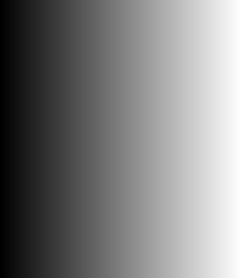|

--------

## Exo6 : Miroir 

|Avant : |Après : |
|-----------|--------|
|||

--------

## Exo7 : Image Bruitée 

|Avant : |Après : |
|-----------|--------|
||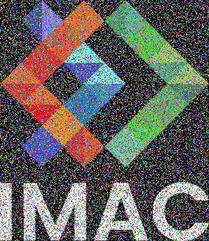|

--------

## Exo8 : Rotation de 90° 

|Avant : |Après : |
|-----------|--------|
|||

--------

## Exo9 : RGB split

|Avant : |Après : |
|-----------|--------|
||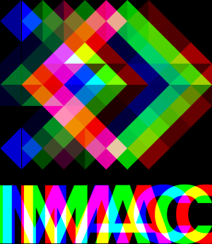|

--------

## Exo10 : Luminosité (assombrissement)

|Avant : |Après : |
|-----------|--------|
|||

--------

## Exo10 : Luminosité (éclaircissement)

|Avant : |Après : |
|-----------|--------|
|||

--------

## Exo11 : Disque

--------

## Exo12 : Cercle

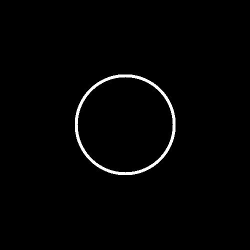|

--------

## Exo13 : Animation

|

--------

## Exo14 : Rosace

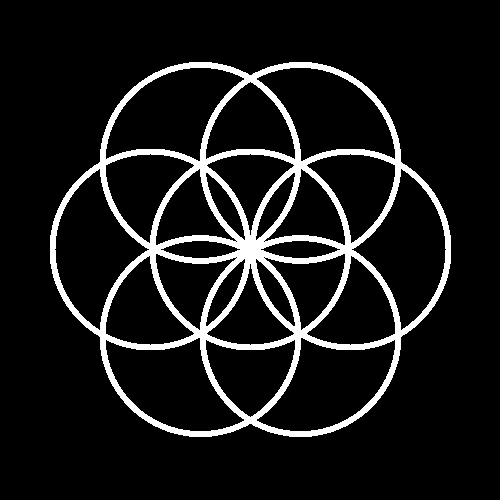|

--------

## Exo15 : Mosaïque

|Avant : |Après : |
|-----------|--------|
|||

--------

## Exo16 : Mosaïque Miroir

|Avant : |Après : |
|-----------|--------|
||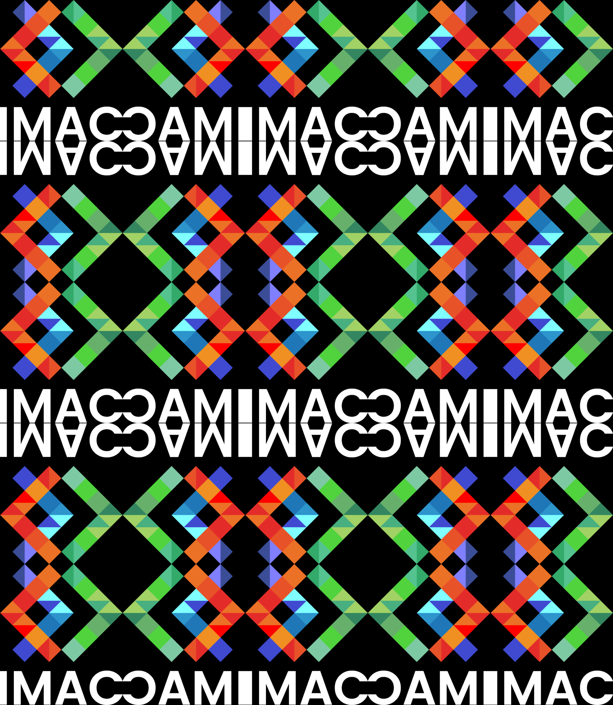|

--------

## Exo17 : Glitch

|Avant : |Après : |
|-----------|--------|
|||

--------

## Exo18 : Tri de pixels

|Avant : |Après : |
|-----------|--------|
||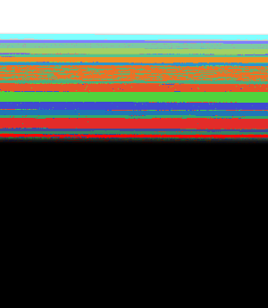|
||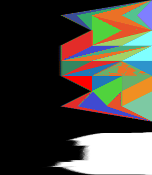|

--------

## Exo19 : Fractale de Mandelbrot

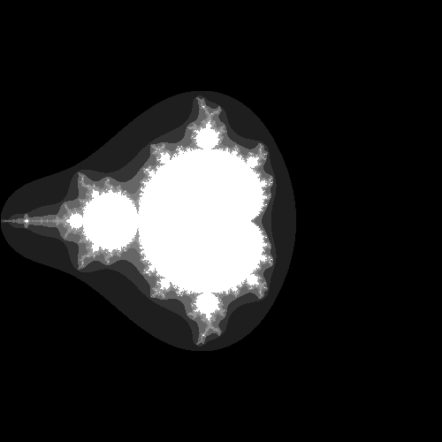

--------

## Exo20 : Dégradé de couleurs

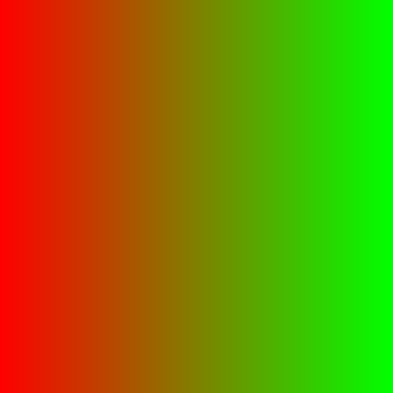

--------

## Exo23 : Vortex

Pour chaque pixel on regarde ca distance par rapport au centre et cela nous donne sa rotation sur l'image finale. Plus la disantce est grande, plus la rotation est importante.

|Avant : |Après : |
|-----------|--------|
||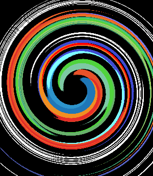|

--------

## Exo24 : Convolution

Pour chaque pixel on regarde un nombre 2*f+1 de pixels autour (plus f est grand plus le résultat sera flou). On fait la moyenne de couleur des pixels regardés et cela nous donne la couleur du pixel de notre résultat.

|Avant : |Après : |
|-----------|--------|
|||

--------

## Exo25 : Contours (Outline)

|Avant : |Après : |
|-----------|--------|
|||

--------

## Exo28 : K-Means

On choisit le nombre de couleurs k que l'on veut sur la photo finale, on prend les couleurs de k pixels au hasard, puis on associe chaque pixel de la photo au pixel "centre" de couleur la plus proche. on fait la moyenne des couleurs de chaque groupe pour obtenir ainsi un nouveau centre.
En répétant ces actions, on obtient finalement les images ci-dessous : 

|Avant : |k = 2 : |k = 3 : | 
|-----------|--------|-----|
||||

--------